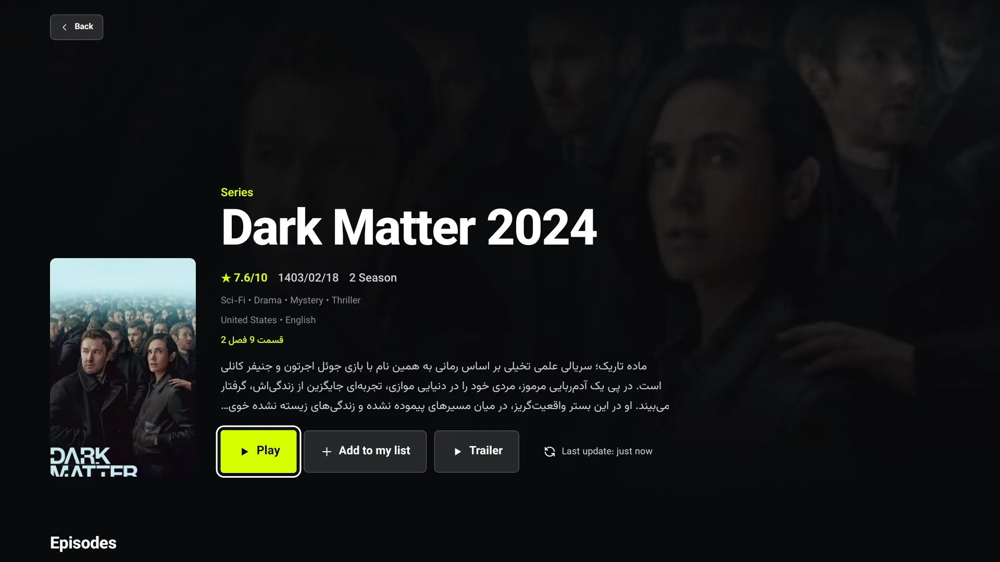

# myMediaTV — landing page

Public marketing page for **myMediaTV**, a Persian Android TV / tvOS client for movies and series.

- Live site: <https://mrsoftware.github.io/myMediaTVLanding/>
- App repository: `mrsoftware/myMediaTV` (**private**)
- Package id: `dev.mrsoftware.mymediatv` · minSdk 24 (Android 7.0)

The site is plain HTML/CSS/JS. There is no build step, no package manager, and no framework — push to `main` and GitHub Pages serves it.

## Local preview

```bash
cd myMediaTVLanding
python3 -m http.server 8123
# http://localhost:8123/
```

Pages uses `/` as its root, so all links are relative (`assets/…`, `styles.css`). Keep it that way; absolute paths break previews and local `file://` checks.

## Repository layout

| Path | Purpose |
| --- | --- |
| `index.html` | Whole page: hero, gallery, features, download, FAQ, footer, inline SVG sprite |
| `styles.css` | All styling; design tokens live in `:root` at the top |
| `app.js` | APK link rewrite, Persian year, sticky header, mobile menu, gallery switcher, scroll reveal |
| `assets/screens/` | 1920×1080 app screenshots (WebP) used by the hero and gallery |
| `assets/fonts/` | Vazirmatn 400/500/700/800 (TTF) + `OFL.txt` license |
| `assets/icon.png` | 512×512 app icon (also `apple-touch-icon`) |
| `assets/favicon.svg` | Inline-style TV mark matching the header logo |
| `assets/og.png` | 1200×630 social preview card |
| `.nojekyll` | Tells Pages to skip Jekyll processing |

The page is Persian RTL (`<html lang="fa" dir="rtl">`). When adding CSS, prefer logical properties (`margin-inline`, `inset-inline-start`) — but the TV mockup's bezel LED, stand and floating chips use physical `left`/`right` on purpose, because they must not mirror.

Palette tokens: `--screen:#08090b`, `--lime:#d6ff00`, `--surface:#17191d`, `--ink:#f7f7f8`, `--line:rgba(255,255,255,.12)`. Do not introduce new accent colors; lime is the only highlight.

## Download / APK hosting

Release assets of the **private** app repo cannot be downloaded anonymously, so the APK is re-published as an asset of this **public** repo. The page never links to the app repo directly.

Stable download URL (used by `APK_URL` in [app.js](app.js#L4) and by the static `href`s in `index.html`):

```
https://github.com/mrsoftware/myMediaTVLanding/releases/latest/download/myMediaTV.apk
```

`releases/latest/download/…` resolves to the newest non-prerelease release and returns a `302` to a short-lived signed CDN URL. Always link the `latest` form — never the signed URL.

### Publishing a new APK

1. Build/release the app in `mrsoftware/myMediaTV` (see that repo's README: `make release`).
2. Copy the APK out of the private release:

   ```bash
   gh release download v1.0.0 -R mrsoftware/myMediaTV --pattern "*.apk" --output /tmp/myMediaTV.apk
   shasum -a 256 /tmp/myMediaTV.apk   # compare with the private release
   ```

3. Create a release here with the asset **named exactly `myMediaTV.apk`**:

   ```bash
   gh release create v1.0.0 "/tmp/myMediaTV.apk#myMediaTV.apk" \
     -R mrsoftware/myMediaTVLanding \
     --title "myMediaTV 1.0.0" \
     --notes "نسخهی ۱.۰.۰ مای مدیا برای Android TV"
   ```

   The `#myMediaTV.apk` suffix is what sets the uploaded filename. In the web UI, upload the file renamed to `myMediaTV.apk`. The download URL is asset-name based, so a different name silently breaks every link.

4. Newer releases automatically become `latest`; no page change is needed for a version bump alone. Do not publish the new release as a prerelease unless it should stay hidden from the download button.

5. Verify:

   ```bash
   curl -sIL https://github.com/mrsoftware/myMediaTVLanding/releases/latest/download/myMediaTV.apk \
     | grep -Ei "^HTTP|^location|^content-length"
   # expect: 302 → release-assets.githubusercontent.com, then 200 with the APK size
   ```

   Confirm the content type is `application/vnd.android.package-archive` and the byte count matches the build.

### Version copy on the page

A visible version bump touches four places in [index.html](index.html):

- hero pill: `نسخه <bdi>۱.۰.۰</bdi>` (~line 73)
- hero specs: version, size, minimum Android (~lines 91–93)
- download panel meta: `نسخه <bdi>1.0.0</bdi> · ۷۷ مگابایت · Android 7.0+` (~line 266)

Persian numerals are used in prose (`۱.۰.۰`, `۷۷`); Latin digits are kept inside `<bdi>` where the string is technical/version-like. Sizes are approximate marketing values, so round them.

## Updating screenshots

Screenshots come from the Android emulator at 1920×1080.

```bash
adb devices
adb exec-out screencap -p > /tmp/mymediatv-shots/details.png
```

Convert to WebP (keep 1920×1080; the CSS crops to 16:9):

```bash
cwebp -q 82 -m 6 -metadata none /tmp/mymediatv-shots/details.png \
  -o assets/screens/details.webp
```

Add a button inside `.gallery-thumbs` in [index.html](index.html#L165). The gallery is data-driven, so no JS change is required:

```html
<button class="thumb" type="button" aria-pressed="false"
  data-image="assets/screens/details.webp"
  data-alt="…"
  data-title="جزئیات عنوان"
  data-caption="…"
  data-index="۴">
  <span class="thumb-frame"></span>
  <span>جزئیات عنوان</span>
</button>
```

- The first button must keep `class="thumb is-active"` and `aria-pressed="true"`.
- The counter is computed in [app.js](app.js#L70) from the number of thumbnails (`[data-gallery-total]`), so it stays correct automatically.
- Grid: 5 columns on desktop, 3 columns at ≤980px.
- Keep `width`/`height` attributes on images; they reserve layout space and prevent the vertical-strip thumbnail bug caused by presentational sizing overriding `aspect-ratio`.

Screenshot hygiene: avoid focus rings on unrelated controls, avoid toast/error overlays, and keep the same show/poster across the set when possible.

## Deployment

GitHub Pages is configured for branch `main`, path `/`:

```bash
gh api repos/mrsoftware/myMediaTVLanding/pages --jq '{url:.html_url,branch:.source.branch}'
```

Any push to `main` triggers a build. Wait for it before verifying the live site:

```bash
for i in 1 2 3 4 5 6; do
  s=$(gh api repos/mrsoftware/myMediaTVLanding/pages/builds/latest --jq .status); echo "$s"
  [ "$s" = "built" ] && break; sleep 15
done
```

Then check the page and the assets over HTTPS, not just locally (cache-bust the HTML with `?v=N` when in doubt):

```bash
curl -s -o /dev/null -w "%{http_code}\n" https://mrsoftware.github.io/myMediaTVLanding/
```

## SEO / social preview

- `og:url`, `og:image` and `canonical` are absolute URLs pointing at `https://mrsoftware.github.io/myMediaTVLanding/`. If the site moves to a custom domain, update all three or social cards and canonical links break.
- `assets/og.png` is 1200×630, composed from the hero TV frame, brand mark and the headline «تلویزیونت را سینما کن» using Vazirmatn. Regenerate it when the hero copy or brand changes.
- Keep one `<h1>`; sections use `<h2>`/`<h3>`. The FAQ uses `<details>` so answers stay crawlable without JS.

## Accessibility / behavior notes

- Gallery thumbnails are real `<button>`s with `aria-pressed`; the caption area is `aria-live="polite"`.
- Images that are decorative inside thumbnails keep `alt=""`; the selected image gets a descriptive `alt` from `data-alt`.
- The reveal animation is CSS-driven and disabled under `prefers-reduced-motion`. Content must remain visible without JS — the `js` class is added inline in `<head>` before CSS loads, so no-JS users never get hidden sections.
- Mobile nav toggles `html.nav-open`, closes on link click, Escape, and resize above 760px.

## Known issues outside this repo

- The app's update config (gist `CONFIG_URL` in the app repo, `src/services/config.ts`) still points at `http://127.0.0.1:8080/app-release.apk`. Installed copies will see a broken update prompt until that points at a reachable URL — ideally a release asset, e.g. the `latest/download/…` pattern above. Fixing it requires changing the gist, not this repository.
